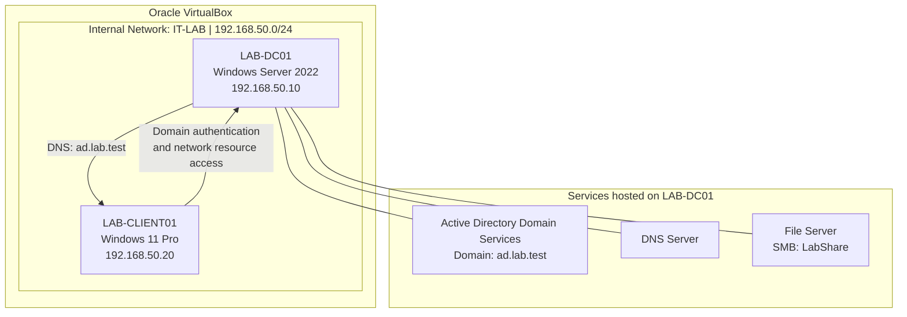

# Infrastructure Diagram

The diagram presents the current virtual lab topology.

## Network Details

| Component | Configuration |
|---|---|
| Virtualization Platform | Oracle VirtualBox |
| Network Type | Internal Network |
| Network Name | `IT-LAB` |
| Network Subnet | `192.168.50.0/24` |
| Domain | `ad.lab.test` |
| Domain Controller | `LAB-DC01` |
| Domain Client | `LAB-CLIENT01` |

## Diagram Scope

The diagram represents the current two-machine lab environment.

Both virtual machines are connected to the same isolated VirtualBox Internal Network. The domain controller provides Active Directory, DNS and SMB file sharing services.

No Internet connection, router, DHCP server or additional domain controller is represented.

